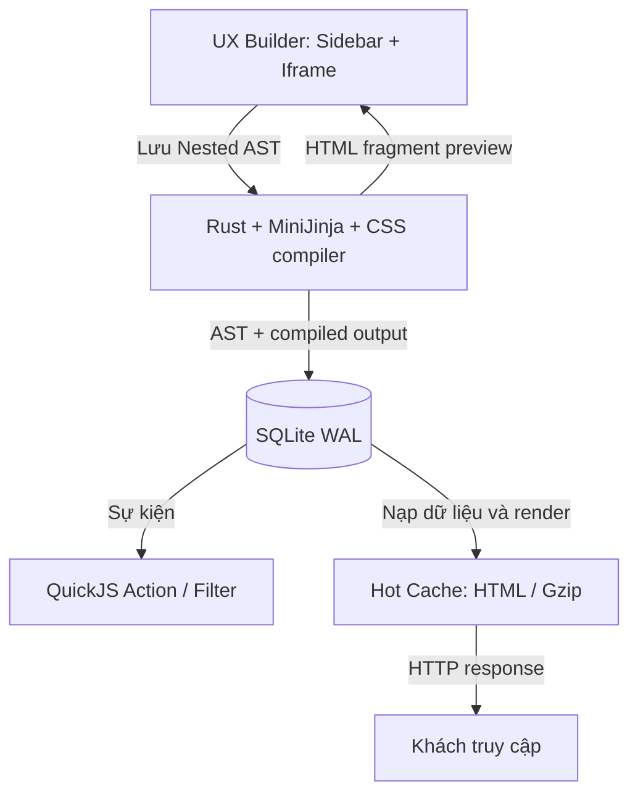

# TÀI LIỆU BÓC TÁCH KỸ THUẬT: KIẾN TRÚC DAYPRESS (RUST CMS)

**Đối tượng phân tích:** Daypress (`github.com/Trooper-lab/daypress`)  
**Mục đích bản gốc:** Giải mã cơ chế hiệu năng cao (< 50µs TTFB, ~18MB RAM) và trích xuất các mẫu thiết kế cho CMS & E-commerce thế hệ mới.  
**Ứng dụng hiện tại:** Tham khảo thiết kế OpenDash, ưu tiên CMS.  
**Ngày đóng gói và ghi nhận đối chiếu:** 2026-11-05.

> **Phân biệt nội dung gốc và kết quả đối chiếu**
>
> Các mục 1–5 khôi phục bản phân tích chủ dự án đã gửi, có chuẩn hóa cách trình bày. Chúng phản ánh mô tả và suy luận trong bản gốc, không mặc nhiên là hành vi đã được kiểm chứng từ mã nguồn hoặc benchmark.
>
> [Phụ lục A](#phụ-lục-a-đối-chiếu-mã-nguồn-và-hiệu-chỉnh) ghi rõ những điểm khác với mã nguồn đã đọc trong phiên thảo luận. Các link nhánh `main` có thể thay đổi; bản này chưa gắn với một commit SHA cố định và chưa có benchmark tự chạy.
>
> Đặc biệt, các nhận định về `sqlx`, loại bỏ `postmeta`, `DashMap`/`Bytes`, zero-copy và các con số hiệu năng cần được đọc cùng phụ lục.

---

## 1. Tổng quan Kiến trúc & Thông số Thực nghiệm — theo bản phân tích gốc

Daypress được mô tả theo triết lý **Zero-Dependency Single Binary**, giải quyết 3 điểm nghẽn của WordPress:

1. **PHP-FPM Worker Overhead:** Thay thế bằng bất đồng bộ đa luồng của Rust (`Tokio` + `Axum`).
2. **Truy vấn EAV (`wp_postmeta` JOIN Hell):** Thay thế bằng cột JSON kết hợp Expression Indexes trong SQLite WAL.
3. **Runtime Shortcode/Block Parsing:** Thay thế bằng Compile-on-Save Dual Storage.

Các chỉ số được nêu trong bản phân tích:

* **Binary:** ~18MB – 24MB, đã nhúng tài nguyên quản trị `/d-admin/`.
* **RAM:** ~18MB idle, ~35MB chịu tải cao.
* **Latency:**
  * In-Memory Gzip Hot Cache: `< 50 µs`.
  * SSR động + SQLite WAL: `0.4 ms – 0.8 ms`.
  * WebP/AVIF và OpenGraph Card: `~4 ms`.

Các số này được giữ để bảo toàn tài liệu đầu vào. Điều kiện đo, dataset, phần cứng và kết quả benchmark độc lập chưa được cung cấp trong phiên.

## 2. Cấu trúc Phân tách Cargo Workspace — theo bản phân tích gốc

Daypress tách các crate để cô lập logic và quản lý biên dịch:

```text
daypress/
├── Cargo.toml
└── crates/
    ├── daypress-server/       # HTTP, Routing, Auth, Cache, Media, Updater
    ├── daypress-ast/          # AST Daystudio & HTML Compiler
    ├── daypress-transpiler/   # Chuyển Elementor/Divi/Gutenberg sang AST
    └── generated_slugify/    # Slug và tương thích WP
```

### Vai trò được mô tả trong bản gốc

* **`daypress-ast`:** Không phụ thuộc database hay HTTP; nhận JSON từ builder, validation và xuất HTML tĩnh kèm scoped CSS.
* **`daypress-transpiler`:** Đọc JSON `_elementor_data` hoặc shortcode Divi bằng Lexer/Parser, ánh xạ sang node của `daypress-ast`.
* **`daypress-server`:** Vòng lặp Tokio, SQLite được bản gốc ghi là `sqlx`, quản trị `/d-admin/*`, API `/wp-json/*` và public SSR.

> Cây workspace có cơ sở từ Cargo manifest. Vai trò chính xác của crate transpiler và driver SQLite được hiệu chỉnh tại phụ lục A.

## 3. Giải mã 5 Cơ chế Kỹ thuật Cốt lõi — theo bản phân tích gốc

### 3.1. Lưu Kép (Dual-Storage Architecture) của Daystudio Builder

Trong mô hình được phân tích, việc lưu và phục vụ nội dung được tách:

```text
[Người dùng kéo thả trên Builder]
        │
        ▼ Bấm Save / Publish
[Gửi cây AST JSON về Rust Server]
        │
        ├──► Lưu ast_json để chỉnh sửa lại
        │
        └──► compile_ast_to_html()
                    │
                    ▼
              Lưu HTML vào post_content
              để phục vụ public
```

#### Node AST được minh họa trong bản gốc

Mỗi khối được mô tả bằng Rust enum có kiểu chặt chẽ và responsive ở các mốc desktop `1200px`, tablet `768px`, mobile `375px`:

```rust
#[derive(Serialize, Deserialize, Clone)]
pub struct AstNode {
    pub id: String,
    pub node_type: NodeType,
    // Section, Container, Grid, Heading, Text, Image,
    // Button, CollectionGrid, SymbolRef
    pub styles: ResponsiveStyles,
    pub props: serde_json::Value,
    pub children: Vec<AstNode>,
}
```

Đoạn này là minh họa của bản phân tích, không phải trích nguyên struct hiện tại trong repository. Kiểu thực tế được dẫn nguồn ở phụ lục A.

#### Synced Symbols

Một nhánh AST dùng chung như Header/Footer/khuyến mãi được lưu thành bản ghi riêng. Các trang con giữ tham chiếu dạng `SymbolRef { symbol_id: "sym_header_01" }`. Khi sửa symbol, bản phân tích mô tả hệ thống tìm trang có tham chiếu, biên dịch lại HTML và làm mới cache.

Đây là mẫu thiết kế đáng tham khảo. Chi tiết cơ chế dependency và việc rebuild mọi trang liên quan chưa được xác minh đầy đủ trong phiên.

### 3.2. SQLite WAL & Loại bỏ `postmeta` — mô tả cần hiệu chỉnh

Cấu hình được nêu trong bản gốc:

```sql
PRAGMA journal_mode = WAL;
PRAGMA synchronous = NORMAL;
PRAGMA mmap_size = 268435456;
PRAGMA temp_store = MEMORY;
PRAGMA cache_size = -64000;
```

Các mục tiêu được giải thích:

* WAL giúp đọc/ghi đồng thời.
* `synchronous = NORMAL` giảm số lần chờ fsync.
* `mmap_size` cho phép truy cập file qua memory mapping.
* `temp_store = MEMORY` đưa các bảng tạm lên bộ nhớ.
* `cache_size = -64000` đặt ngân sách page cache khoảng 64MB.

Bản gốc mô tả việc gom fields vào `structured_fields` thay vì EAV để tránh nhiều phép JOIN, đồng thời suy luận rằng dữ liệu nằm liền nhau và CPU đọc toàn bộ trong một lần truy cập bộ nhớ.

**Hiệu chỉnh quan trọng:** Không suy ra tính chất “một lần truy cập bộ nhớ” từ JSON hay mmap. Cũng không kết luận Daypress đã bỏ hoàn toàn `postmeta`; mã nguồn đã đọc vẫn giữ bảng đó. Xem phụ lục A.

### 3.3. CollectionGrid và Truy vấn Lọc dưới 1ms — mô tả bản gốc

Bản gốc kết hợp hai kỹ thuật:

1. **JSON Expression Indexing:**

   ```sql
   CREATE INDEX idx_posts_cf_price
   ON posts(json_extract(structured_fields, '$.price'));
   ```

2. **Endpoint `/wp-json/daypress/v1/collection-query`:**
   * CollectionGrid gắn JavaScript thuần khoảng 1.5KB.
   * Khi lọc/phân trang, JavaScript gọi endpoint, nhận HTML do Rust render rồi thay grid.
   * Khi tắt JavaScript, liên kết `<a href="?page=2&cat=news">` vẫn điều hướng bình thường, phục vụ SEO và progressive enhancement.
   * Mốc “dưới 1ms” trong bản gốc cần được phân biệt giữa server processing và cập nhật end-to-end trên trình duyệt.

Expression index và endpoint trên là mô tả đầu vào; chưa xác minh đầy đủ toàn bộ pipeline truy vấn, JavaScript và độ trễ trong phiên. Việc không thấy `CREATE INDEX` hoặc `json_extract` trong riêng một file đã đọc không đủ để kết luận chúng vắng mặt trong repository.

### 3.4. Sub-50µs In-Memory Gzip Hot Cache — mô hình được phân tích

```text
[HTTP GET Request từ Khách]
        │
        ▼ Kiểm tra cookie đăng nhập
        ├── Có ──► SSR động, bypass cache
        │
        └── Không ──► Tra cứu URI trong cache RAM
                           │
                           ├── HIT ──► If-None-Match / ETag
                           │              ├── Khớp: 304, không body
                           │              └── Không: body gzip
                           │
                           └── MISS ──► SQLite -> HTML -> Gzip
                                         -> Cache -> Response
```

Struct minh họa của bản phân tích:

```rust
pub struct CachedEntry {
    pub gzipped_body: Bytes,
    pub etag: HeaderValue,
    pub content_type: HeaderValue,
}
```

Bản gốc giải thích rằng `Bytes` dùng reference counting nên nhiều request không cần nhân bản toàn bộ HTML buffer, và từ đó mô tả việc đưa dữ liệu ra socket là “zero-copy”.

**Phân biệt:** Đây là cấu trúc đề xuất/thuyết minh trong bản gốc. Cache thực tế đã đọc dùng cấu trúc khác, và đường tạo body vẫn clone `Vec`. Dùng `Bytes` có thể giảm copy ở tầng ứng dụng; không tự động đảm bảo zero-copy xuyên suốt kernel, TLS và socket.

### 3.5. Media, OG Image Generator & Static Edge Publisher — mô tả bản gốc

* **Media pipeline:** Upload multipart qua `/d-admin/media`, đọc byte trên RAM, giải mã ảnh, xoay theo EXIF, cắt các kích thước `thumbnail`/`medium`/`large`, mã hóa WebP/AVIF và ghi đĩa.
* **OpenGraph Social Cards:** Dùng thư viện đồ họa 2D để ghép tiêu đề, tác giả, logo lên ảnh `1200x630px`. Mức `4ms` là con số bản gốc nêu, chưa được xác nhận trong phiên.
* **Static Edge Publisher:** Crawler nội bộ duyệt URL publish, xuất HTML tĩnh rồi deploy Cloudflare Pages hoặc Netlify qua API.

README hiện mô tả các tính năng liên quan, nhưng sự tồn tại của tính năng không xác nhận mọi chi tiết pipeline hoặc mọi con số đo trong bản phân tích.

## 4. Điểm Mạnh vs. Hạn chế — quyết định của bản thiết kế ban đầu

> Bảng này giữ lại hướng lựa chọn ban đầu để truy vết. Những cụm “giữ nguyên 100%”, “hoàn hảo” và cam kết RAM/latency phải được thay bằng đánh giá theo workload thực tế khi viết đặc tả triển khai.

| Hạng mục | Cách Daypress được mô tả trong bản gốc | Lựa chọn ban đầu cho OpenDash |
| :--- | :--- | :--- |
| **Core Server & DB** | Axum + SQLite WAL/mmap, single binary | Giữ nền tảng Rust + SQLite để hướng tới RAM thấp và SSR nhanh. |
| **Dual-Storage** | Lưu AST và HTML khi Save | Giữ compile-on-save, giảm việc phân tích layout trên public request. |
| **Hot Cache** | DashMap + Bytes gzip + ETag | Giữ ý tưởng byte nén sẵn; đây chưa phải mô tả đúng implementation Daypress hiện đã đọc. |
| **CPT & Fields** | JSON trên bảng chính + expression index | Áp dụng cho content modeling; cần typed fields và query được kiểm tra. |
| **Page Builder** | Daystudio thao tác trực tiếp trên canvas | Thay bằng Sidebar Tree + Options + Element Picker, iframe sạch kiểu Flatsome. |
| **Theme** | Block gắn chặt với Rust | Mở `/themes/`, MiniJinja + schema.json, cài theme không biên dịch lại. |
| **Plugin** | Chưa có runtime script động được xác nhận | Bổ sung QuickJS cùng Action/Filter và quyền hạn. |
| **E-commerce** | Không có lõi bán hàng theo tài liệu tham khảo | Xây sau; ưu tiên CMS ở giai đoạn hiện tại. |
| **WP compatibility** | REST tương thích và import Elementor/Divi | Không triển khai WP REST compatibility hay migration builder trong MVP. |

Bản gốc cũng gắn việc bỏ tương thích WP với tránh AGPLv3. Cần tách hai quyết định: bỏ tính năng tương thích là lựa chọn phạm vi; việc tái sử dụng mã nguồn cần xem license của chính mã được dùng. Xem phụ lục A.8.

## 5. Luồng Dữ liệu Tổng hợp — mô hình OpenDash được đề xuất trong bản gốc



Sơ đồ mô tả ý tưởng thiết kế, không phải sơ đồ đã xác minh toàn bộ luồng gọi trong Daypress. Luồng CMS-first cập nhật của OpenDash được trình bày trong file 03.

## Phụ lục A. Đối chiếu mã nguồn và hiệu chỉnh

### A.1. SQLite driver và concurrency

`Cargo.toml` khai báo `rusqlite`; adapter lưu một connection trong `Arc<Mutex<Connection>>`. Không dùng mô tả `sqlx` làm cơ sở để suy ra connection pool hay concurrency của Daypress.

Nguồn:

* [Workspace Cargo.toml](https://github.com/Trooper-lab/Daypress/blob/main/Cargo.toml)
* [Database adapter](https://github.com/Trooper-lab/Daypress/blob/main/crates/daypress-server/src/adapters/database/mod.rs)

### A.2. Daypress vẫn có postmeta

`save_post_layout` lưu `posts.layout_json`, đồng bộ `postmeta._daypress_layout` và có thể cập nhật HTML trong `posts.post_content` trong transaction. Vì vậy, “loại bỏ hoàn toàn postmeta” không đúng với mã đã đọc. OpenDash vẫn có thể chủ động chọn JSON fields và schema mới cho riêng mình.

Nguồn: [post_ast.rs](https://github.com/Trooper-lab/Daypress/blob/main/crates/daypress-server/src/adapters/database/post_ast.rs).

### A.3. Cache thực tế khác struct minh họa

`hot_cache.rs` dùng `RwLock<HashMap<String, CachedSsrEntry>>`, giữ raw/gzip qua `Arc<Vec<u8>>` và tính ETag từ SHA-256 rút gọn. Trong `build_cached_response`, clone được gọi trên `Vec` để tạo body.

Ý tưởng pre-compressed cache có trong mã; mô tả “DashMap + Bytes + không copy body” chưa khớp implementation đó.

Nguồn: [hot_cache.rs](https://github.com/Trooper-lab/Daypress/blob/main/crates/daypress-server/src/hot_cache.rs).

### A.4. AST và vai trò crate

Node thực tế có dạng `DaypressNode` với `id`, `kind: NodeKind`, `styles` và `children`. Đoạn `AstNode` tại mục 3.1 là schema minh họa.

Tài liệu kiến trúc repository đặt phần chuyển Elementor/Divi/Gutenberg trong `daypress-ast`; `daypress-transpiler` được mô tả là CLI phục vụ pipeline chuyển đổi/verification mã. Vì vậy, phần phân vai ở mục 2 cần được xác minh theo code thay vì giữ nguyên suy luận.

Nguồn:

* [AST node](https://github.com/Trooper-lab/Daypress/blob/main/crates/daypress-ast/src/schema/node/mod.rs)
* [Daypress ARCHITECTURE.md](https://github.com/Trooper-lab/Daypress/blob/main/ARCHITECTURE.md)

### A.5. mmap, page cache và WAL

`mmap_size` là giới hạn kích thước mapping được phép dùng, không phải cấp sẵn từng đó RAM. `cache_size` đặt mức page cache đề xuất; implementation mặc định cấp dần theo nhu cầu. JSON trong một cột không đảm bảo bản ghi vừa một database page hoặc một CPU memory access.

WAL vẫn có một writer tại một thời điểm. Chế độ NORMAL có tradeoff về độ bền trước mất điện; không diễn đạt thành bảo đảm tuyệt đối không mất transaction gần nhất.

Đoạn khởi tạo database đã đọc trực tiếp bật WAL, NORMAL và foreign keys. Chưa xác minh cấu hình mmap/cache trên mọi đường khởi tạo của chương trình.

Nguồn:

* [SQLite PRAGMA documentation](https://www.sqlite.org/pragma.html)
* [Database initialization](https://github.com/Trooper-lab/Daypress/blob/main/crates/daypress-server/src/adapters/database/schema.rs)

### A.6. Trạng thái hiệu năng

README tự mô tả hot cache và mốc dưới 50µs, đồng thời ghi rằng benchmark tải so sánh công khai còn được lên kế hoạch cho 1.0. Trong phiên thảo luận chưa build, chạy load test, đo RAM hay đo xử lý ảnh.

Do đó, chưa dùng các con số 18MB, 35MB, 0.4–0.8ms hay 4ms làm SLA cho OpenDash. Cần đo p50/p95/p99 cùng phần cứng, dataset, payload, trạng thái cache và concurrency cụ thể.

Nguồn: [Daypress README — Performance and security](https://github.com/Trooper-lab/Daypress#readme).

### A.7. Tính năng được mô tả và hành vi đã chứng minh

README nêu CPT/structured fields, templates/symbols/collections, media, OG cards và static publishing. Đây là thông tin do dự án công bố. Phiên này không kiểm thử end-to-end các tính năng đó, cũng không xác nhận mọi route, kích thước JavaScript hay chiến lược rebuild trong bản phân tích gốc.

Nguồn: [Daypress README](https://github.com/Trooper-lab/Daypress#readme).

### A.8. Phạm vi WP compatibility và license

Workspace khai báo `AGPL-3.0-or-later`, đồng thời repository có tài liệu license thương mại riêng. Việc không triển khai WP API/importer chỉ là quyết định phạm vi của OpenDash; không dùng quyết định đó để suy ra điều kiện tái sử dụng mã Daypress.

Tài liệu này tham khảo ý tưởng kiến trúc và ghi nguồn, không đóng gói mã nguồn Daypress. Nếu sau này tái sử dụng code, cần xác định license áp dụng cho phần code cụ thể.

Nguồn:

* [Cargo.toml — license declaration](https://github.com/Trooper-lab/Daypress/blob/main/Cargo.toml)
* [Daypress LICENSE](https://github.com/Trooper-lab/Daypress/blob/main/LICENSE)
* [Commercial license document](https://github.com/Trooper-lab/Daypress/blob/main/LICENSE-COMMERCIAL.md)

## Phụ lục B. Mẫu thiết kế nên kế thừa cho OpenDash

| Mẫu thiết kế | Cách áp dụng |
|---|---|
| Single executable + thư mục dữ liệu | Đơn giản hóa vận hành một website trên VPS. |
| AST tách biệt HTTP/DB | Dễ validation, migration, kiểm thử và dựng builder. |
| Compile-on-save | Dịch phần nội dung tĩnh khi publish, giữ AST để chỉnh sửa. |
| Dynamic rendering có kiểm soát | Field bindings và collections đi qua context/query contract rõ ràng. |
| Pre-compressed cache | Tối ưu sau khi public renderer và invalidation đã đúng. |
| JSON custom fields | Giảm schema churn; đánh index theo loại dữ liệu và nhu cầu truy vấn. |
| Symbols + dependency tracking | Rebuild đúng artifact khi nội dung dùng chung thay đổi. |
| Progressive enhancement | Filter và phân trang hoạt động bằng URL chuẩn trước khi nâng cấp bằng JS. |

Thiết kế triển khai đề xuất: [03_OpenDash_CMS_PROPOSAL.md](03_OpenDash_CMS_PROPOSAL.md).
